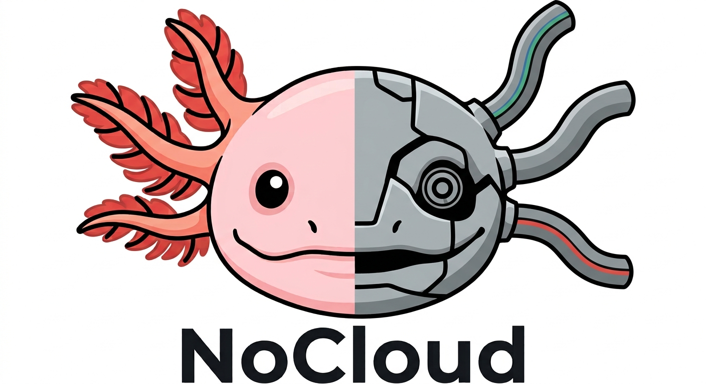

<p align="center">
  
</p>

# NoCloud

**Un asistente de programación con IA, portátil y sin internet.**
Vive en una memoria USB, se conecta a cualquier PC con Windows y crea archivos de código reales (`.py`, `.js`, `.css`, `.sql`...) sin instalar nada y sin depender de la nube.

> Sin servidor. Sin conexión. Sin instaladores. Solo una PC, una terminal y una USB.

---

## ¿Qué hace?

- Le pides en español qué programa necesitas y **crea o edita los archivos directamente en tu carpeta de proyecto**, no solo te muestra código en un chat.
- Funciona **100 % offline** una vez que todo está descargado.
- Es **portátil**: todo (motor, modelo, Python, voz) viaja dentro de la USB.
- Un menú de arranque (`nocloud-inicio.bat`) con saludo por voz, para no escribir comandos largos cada vez.

## Cómo funciona

```
 Tú (terminal)
      │  "crea un archivo servidor.js ..."
      ▼
  ┌────────┐    API compatible con OpenAI     ┌──────────────────────────┐
  │ Aider  │ ───────────────────────────────▶ │ KoboldCpp (llama.cpp)    │
  │ (crea  │   http://localhost:5001/v1       │  + Qwen2.5-Coder-7B GGUF │
  │ archivos)◀─────────────────────────────── │  corre en CPU, en local  │
  └────────┘                                   └──────────────────────────┘
      │
      ▼
  Archivos reales en  proyectos/   → los abres en tu IDE (VS Code, etc.)

  Saludo por voz: nocloud-voz.vbs → Piper (voz es_MX en la USB)
                                    └─ respaldo: voz de Windows
```

| Pieza | Para qué sirve |
|---|---|
| **KoboldCpp** | Ejecuta el modelo en local (un solo `.exe`, sin instalación) y expone una API compatible con OpenAI. |
| **Qwen2.5-Coder-7B-Instruct** (GGUF, Q4_K_M) | El modelo de IA especializado en código. |
| **Aider** | Conecta el modelo con tus archivos: lee, crea y edita código en disco. |
| **Python embebible 3.12** | Permite correr Aider desde la USB sin instalar Python en la PC. |
| **Piper** (opcional) | Voz propia guardada en la USB para el saludo. |

## Estructura de la USB

```
USB/
├── koboldcpp.exe
├── qwen2.5-coder-7b-instruct-q4_k_m.gguf
├── nocloud-inicio.bat          ← menú de arranque (doble clic)
├── nocloud-voz.vbs             ← saludo por voz (Piper, con respaldo de Windows)
├── nocloud-voces.vbs           ← diagnóstico: lista las voces instaladas en la PC
├── python portable/
│   └── python-3.12.10-embed-amd64/   ← Python embebible + Aider instalado
├── voz/
│   ├── piper_windows_amd64/    ← programa Piper
│   ├── es_MX-claude-high.onnx
│   └── es_MX-claude-high.onnx.json
└── proyectos/                  ← aquí se crean tus archivos
```

Los scripts de este repositorio van en la **raíz de la USB**. Los archivos pesados (modelo, `koboldcpp.exe`, Python, voz) **no están en el repositorio**: se descargan con los pasos de abajo.

## Instalación (se hace una sola vez, con internet)

Formatea la USB en **exFAT** (FAT32 no admite archivos de más de 4 GB y el modelo pesa ~4.7 GB).

1. **KoboldCpp.** Descarga `koboldcpp.exe` desde las [releases oficiales](https://github.com/LostRuins/koboldcpp/releases/latest) y ponlo en la raíz de la USB.
   > Cuidado: `koboldcpp.com` **no** es el sitio oficial.
2. **Modelo.** Descarga `qwen2.5-coder-7b-instruct-q4_k_m.gguf` (4.68 GB) desde [Qwen/Qwen2.5-Coder-7B-Instruct-GGUF](https://huggingface.co/Qwen/Qwen2.5-Coder-7B-Instruct-GGUF/tree/main) y ponlo en la raíz.
3. **Python portátil.** Descarga [python-3.12.10-embed-amd64.zip](https://www.python.org/ftp/python/3.12.10/python-3.12.10-embed-amd64.zip) y descomprímelo en `python portable/`.
   - Abre `python312._pth` y quita el `#` de la línea `#import site`.
   - Descarga [get-pip.py](https://bootstrap.pypa.io/get-pip.py) en esa misma carpeta.
   - En PowerShell, dentro de esa carpeta (usa siempre `.\python.exe`, no `python.exe` a secas, para no ejecutar otro Python instalado en la PC):
     ```powershell
     .\python.exe get-pip.py
     .\python.exe -m pip install aider-chat
     ```
4. **Voz (opcional).** Descarga Piper de [rhasspy/piper](https://github.com/rhasspy/piper/releases/tag/2023.11.14-2) (`piper_windows_amd64.zip`) y una voz en español de [rhasspy/piper-voices](https://huggingface.co/rhasspy/piper-voices/tree/main/es/es_MX) (el `.onnx` **y** el `.onnx.json`). Pon todo dentro de `voz/`. Deja **una sola** voz (`.onnx`) en esa carpeta.
   Si no instalas la voz, el saludo usa la voz de Windows.
5. Copia los archivos de la carpeta `scripts/` de este repositorio a la raíz de la USB.

## Uso

1. Conecta la USB y abre **`nocloud-inicio.bat`** (el saludo suena al abrir).
2. Opción **[1]**: carga el modelo (espera a que termine de cargar).
3. Opción **[2]**: abre Aider conectado al modelo, en la carpeta `proyectos/`.
4. Escribe lo que necesitas, por ejemplo:
   ```
   crea un archivo llamado servidor.js con un servidor básico en Express
   ```
5. Confirma con `Y` y el archivo aparece en `proyectos/`.

> Cuando Aider pregunte por Git, responde `N` (así no depende de que la PC tenga Git).
> El `.bat` usa `%~dp0`, por lo que funciona sin importar qué letra de unidad tome la USB.

Para cambiar el saludo, edita la frase entre comillas en la línea `start "" wscript ...` de `nocloud-inicio.bat`. La primera vez que se dice una frase nueva tarda un poco en generarse; después queda guardada en `voz/cache` y suena casi al instante.

## Resultados probados

- Generación de archivos reales en Python y SQL (por ejemplo, un esquema de inventario para una tienda de electrónicos).
- Funcionamiento verificado en **dos computadoras Windows distintas**, con distinta letra de unidad.

## Límites (a propósito, sin maquillar)

- **Solo Windows.** El Python embebible y los scripts `.bat`/`.vbs` son de Windows.
- **Velocidad.** Corre en CPU: con un i7-8700 y 16 GB de RAM funciona, pero las respuestas no son inmediatas. Un modelo más grande sería más lento.
- **RAM.** El modelo ocupa varios GB; en equipos con poca memoria conviene cerrar otros programas.
- **Equipos restringidos.** Algunas PCs corporativas o escolares bloquean ejecutar `.exe` desde USB.
- **Sin memoria entre sesiones.** El modelo no aprende de tus conversaciones; cada sesión de Aider empieza de cero.
- **Aider con modelos pequeños.** Un modelo de 7B puede equivocarse al editar archivos; revisa siempre lo que genera.

## Pendientes

- [ ] Activar el repo-map de Aider para proyectos de varios archivos
- [ ] Modo "explicar error" en español simple
- [ ] Librería de snippets propios
- [ ] Entrada por voz (hablarle al asistente) con reconocimiento offline
- [ ] Git portable
- [ ] Probar aceleración con GPU integrada (Vulkan)

## Créditos y licencias

NoCloud **integra** herramientas de terceros; no las modifica ni las incluye en este repositorio:

- [Qwen2.5-Coder](https://huggingface.co/Qwen/Qwen2.5-Coder-7B-Instruct-GGUF), del equipo Qwen (Alibaba Cloud). Licencia Apache-2.0.
- [KoboldCpp](https://github.com/LostRuins/koboldcpp), sobre [llama.cpp](https://github.com/ggml-org/llama.cpp).
- [Aider](https://aider.chat).
- [Piper](https://github.com/rhasspy/piper) y sus voces (el repositorio de Piper está archivado desde octubre de 2025).

Revisa la licencia de cada componente antes de redistribuirlo. Los scripts, la documentación y el nombre NoCloud de este repositorio son obra de Kevin Huesca **(DevInsights)** y se publican bajo licencia MIT (ver `LICENSE`).

El logo se generó con una herramienta de IA a partir de la idea de su autor.
